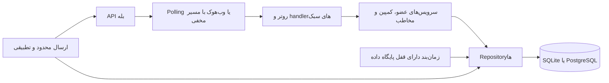

# ربات کمپین بله

رباتی خودمیزبان و تک‌کسب‌وکاره برای ارسال کمپین در بله. مدیر کسب‌وکار پیام کمپین را در بله می‌سازد و ربات همان پیام را برای مشترکانی کپی می‌کند که با `/start` عضویت را انتخاب کرده‌اند. برچسب مخاطبان، زمان‌بندی، آمار ارسال، تطبیق فایل شماره‌ها و پایگاه داده SQLite یا PostgreSQL پشتیبانی می‌شود.

این پروژه مستقل و متن‌باز است و وابستگی یا تأیید رسمی از بله ندارد.

## محدودیت‌ها را بدانید

- ربات فقط می‌تواند به کاربرانی پیام بدهد که آن را شروع کرده‌اند. شماره تلفن واردشده هرگز به‌تنهایی اشتراک نمی‌سازد و امکان پیام مستقیم به آن وجود ندارد.
- تطبیق شماره فقط مشترکانی را پیدا می‌کند که داوطلبانه شماره را به ربات داده و پیوند داده‌اند. `/stop` عضویت را فوراً لغو می‌کند و آن کاربر از کمپین‌های بعدی حذف می‌شود.
- بله نرخ امن ارسال عمومی و ثابتی اعلام نکرده است. از مقدار کم شروع کنید و نتیجهٔ واقعی را بررسی کنید؛ مقدار پیش‌فرض تضمین بله نیست.
- امکان افزودن دکمهٔ اینلاین به `copyMessage` در مستندات مشخص نشده است. دکمه‌های پیگیری و پیام پایانی فعال، جداگانه فرستاده می‌شوند.
- بله کلید جلوگیری از تکرار برای کپی کمپین ارائه نمی‌کند. اگر فرایند بعد از پذیرش پیام توسط بله و پیش از ثبت نتیجه در پایگاه داده متوقف شود، ممکن است تعدادی از گیرندگان همان دستهٔ محدود پیام تکراری بگیرند (حداکثر ۱۰۰ و پیش‌فرض ۱۰ نفر).
- رفتار وب‌هوک و بعضی جزئیات خطا باید با ربات واقعی بررسی شوند. روش پیش‌فرض دریافت به‌صورت polling است و به HTTPS عمومی نیاز ندارد.

## راه‌اندازی پنج‌دقیقه‌ای

۱. با حساب ساخت ربات بله (معمولاً `@botfather`) ربات بسازید و توکن آن را بردارید.
۲. Python 3.12 و [uv](https://docs.astral.sh/uv/) را نصب و مخزن را دریافت کنید.
۳. دستورهای زیر را اجرا کنید:

```sh
uv sync --locked --all-groups
uv run python -m bale_campaign_bot.cli init
```

ویزارد توکن را با `getMe` بررسی می‌کند و فایل‌های `.env` و `config/business.yaml` را با دسترسی محدود `0600` می‌نویسد. پیش از جایگزینی فایل موجود تأیید می‌گیرد.

۴. فضای داده را آماده و ربات را اجرا کنید:

```sh
mkdir -p data
sudo chown 10001:10001 data
docker compose up --build -d
docker compose logs -f bot
```

۵. کد یک‌بارمصرف `/claim CODE` را از لاگ اجرای نخست بردارید و در گفت‌وگوی خصوصی با ربات بفرستید. اولین کد معتبر، مالک ربات می‌شود. تا زمان انقضا یا استفاده، لاگ را خصوصی نگه دارید.

برای اجرای بدون Docker از `uv run python -m bale_campaign_bot.main` استفاده کنید. دستور `uv run python -m bale_campaign_bot.cli doctor` توکن، پیکربندی، پایگاه داده، مهاجرت‌ها و وضعیت دریافت بله را بررسی می‌کند.

## تجربهٔ مشترک

کاربر با `/start` عضو می‌شود و متن رضایت، خوش‌آمدگویی و منو را می‌بیند. با `/stop` هر زمان می‌تواند خارج شود. اگر پیوند شماره فعال باشد، دکمهٔ بله از کاربر می‌خواهد شمارهٔ خودش را بفرستد؛ شمارهٔ متعلق به شخص دیگر پذیرفته نمی‌شود. ارسال دوبارهٔ `/start` عضویت را مجدداً فعال می‌کند.

## فرمان‌های مدیر

همهٔ فرمان‌ها فقط از شناسهٔ مجاز و در گفت‌وگوی خصوصی پذیرفته می‌شوند.

| فرمان | کارکرد |
| --- | --- |
| `/claim CODE` | دریافت مالکیت یک‌باره با کد موقت کنسول |
| `/campaign` | آغاز ویزارد فارسی کمپین |
| `/campaigns` | فهرست کمپین‌ها و کنترل آن‌ها |
| `/pause_ID`، `/resume_ID`، `/cancel_ID` | توقف، ادامه یا لغو کمپین با شناسهٔ فهرست |
| `/tag create NAME`، `/tag assign NAME CHAT_ID` | ساخت و تخصیص برچسب مخاطب |
| `/import` | دریافت فایل CSV/TXT و گزارش تطبیق شماره‌ها |
| `/addadmin USER_ID` | افزودن مدیر از حساب مالک |
| `/stats` | نمایش آمار کمپین‌ها |

## پیکربندی و عملیات

- متغیرها و اطلاعات کسب‌وکار: [راهنمای پیکربندی](docs/CONFIGURATION.md)
- استقرار، پشتیبان‌گیری، پراکسی HTTPS و PostgreSQL: [راهنمای استقرار](docs/DEPLOYMENT.md)
- معماری و تضمین تحویل: [معماری](docs/ARCHITECTURE.md)
- رفتارهای بله و فهرست بررسی زنده: [یادداشت API بله](docs/BALE_API_NOTES.md)

دستورهای پرکاربرد:

```sh
uv run python -m bale_campaign_bot.cli doctor
uv run python -m bale_campaign_bot.cli migrate
uv run python -m bale_campaign_bot.cli import-contacts contacts.csv
uv run python -m bale_campaign_bot.cli export subscribers.csv
uv run python -m bale_campaign_bot.cli export subscribers.csv --include-inactive
```

## معماری



## تصاویر

تصاویر پس از بررسی دستی با ربات زنده اضافه می‌شوند. اطلاعات واقعی مشترکان نباید در تصویرها نمایش داده شود.

## پرسش‌های رایج

**آیا می‌توان شماره تلفن را وارد کرد و به آن پیام داد؟** خیر. فایل فقط شماره را با عضو فعالی تطبیق می‌دهد که خودش ربات را شروع کرده و شماره را پیوند داده است. شماره‌های پیدا‌نشده قابل پیام نیستند.

**آیا بدون سرور عمومی کار می‌کند؟** بله؛ روش پیش‌فرض polling است. وب‌هوک به HTTPS عمومی روی درگاه پشتیبانی‌شدهٔ ۴۴۳ یا ۸۸ و پراکسی معکوس نیاز دارد.

**آیا چند پردازش ربات از یک پایگاه داده استفاده کنند؟** قفل پایگاه داده کار ارسال کمپین را سری می‌کند، اما دریافت پیام‌ها برای یک توکن باید در یک پردازش انجام شود. چند نمونهٔ ورودی برای یک توکن اجرا نکنید.

**آیا نرخ ارسال را بالا ببرم؟** بله سقف ثابت و عمومی منتشر نکرده است. نرخ را آرام افزایش دهید و خطاهای 429، مسدودشدن و بازخورد کاربران را بررسی کنید.

## استفادهٔ مجاز و مسئولانه

مسئولیت رعایت شرایط بله و قوانین حریم خصوصی، حقوق مصرف‌کننده و پیام‌های تبلیغاتی بر عهدهٔ بهره‌بردار است. فقط برای افراد رضایت‌داده پیام بفرستید، متن رضایت را روشن بنویسید، اطلاعات غیرضروری را نگه ندارید و درخواست `/stop` را فوراً اجرا کنید. برای دورزدن الزام شروع ربات یا پیام‌دادن بدون رضایت از فایل شماره استفاده نکنید.

## توسعه

```sh
make setup
make lint
make typecheck
make test
```

روش مشارکت در [CONTRIBUTING.md](CONTRIBUTING.md) آمده است. مجوز MIT در فایل [LICENSE](LICENSE) قرار دارد.
