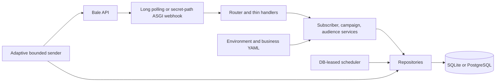

# Bale Campaign Bot

A self-hosted, single-business campaign bot for Bale. It broadcasts a campaign by copying a message authored by the business admin to subscribers who have opted in by starting the bot. It supports audience tags, scheduled sends, delivery tracking, CSV phone matching, and SQLite or PostgreSQL.

This is an independent open-source project and is not affiliated with Bale.

## Honest limitations

- A bot can message only users who have started it. An imported phone number is never a subscriber and cannot be messaged directly.
- Phone matching only finds subscribers who voluntarily shared and linked that number. `/stop` opts out immediately; future campaigns exclude the user.
- Bale does not document a safe broadcast rate. Start low and tune from your own live results. The default is an operator-controlled starting point, not a platform guarantee.
- Bale does not document `copyMessage` with an inline-keyboard override. CTA buttons and an enabled footer are separate follow-up messages.
- Bale does not provide an idempotency key for campaign copies. A crash after Bale accepts a message but before the database records it can produce a duplicate for a recipient in the current bounded batch (100 maximum; 10 by default).
- Webhook delivery behavior and several error details need live verification. Long polling is the default and works without public HTTPS ingress.

## Five-minute quickstart

1. Create a bot with Bale's bot-creation account (commonly `@botfather`) and copy its token.
2. Install Python 3.12 and [uv](https://docs.astral.sh/uv/), then clone this repository.
3. Run `uv sync --locked --all-groups` and `uv run python -m bale_campaign_bot.cli init`. The wizard validates the token with `getMe`, writes `.env` and `config/business.yaml` with mode `0600`, and asks before replacing existing files.
4. Prepare writable data storage, then start Docker:

   ```sh
   mkdir -p data
   sudo chown 10001:10001 data
   docker compose up --build -d
   docker compose logs -f bot
   ```

5. Copy the one-time `/claim CODE` from the first-run bot logs and send it to your bot in a private chat. The first valid claim becomes the owner. Keep logs private until the code expires or is claimed.

You can also run locally without Docker: `uv run python -m bale_campaign_bot.main`. Use `uv run python -m bale_campaign_bot.cli doctor` to check token, config, database, migrations, and Bale's reported intake state.

## What subscribers experience

Users send `/start` to opt in and see the configured consent text, welcome message, and menu. They send `/stop` to opt out. If phone linking is enabled, Bale's contact button asks the user to share their own contact; contacts belonging to another user are rejected. A later `/start` explicitly re-subscribes.

## Admin commands

All admin commands require an allowlisted sender ID in a private chat.

| Command | Action |
| --- | --- |
| `/claim CODE` | Claim owner once using the console-generated expiring code. |
| `/campaign` | Start the Persian campaign wizard. |
| `/campaigns` | Show campaign history and controls. |
| `/pause_ID`, `/resume_ID`, `/cancel_ID` | Control a campaign by the ID shown in the list. |
| `/tag create NAME`, `/tag assign NAME CHAT_ID` | Create and assign audience tags. |
| `/import` | Ask for a CSV/TXT phone file and report linked matches. |
| `/addadmin USER_ID` | Add an admin from the owner account. |
| `/stats` | Show current campaign totals. |

## Configuration and operation

- Business fields and environment variables: [docs/CONFIGURATION.md](docs/CONFIGURATION.md)
- Deployment, backups, reverse proxy, and PostgreSQL: [docs/DEPLOYMENT.md](docs/DEPLOYMENT.md)
- Architecture and delivery guarantee: [docs/ARCHITECTURE.md](docs/ARCHITECTURE.md)
- Bale behavior, assumptions, and live verification checklist: [docs/BALE_API_NOTES.md](docs/BALE_API_NOTES.md)
- Technical decisions: [docs/DECISIONS.md](docs/DECISIONS.md)

Common local operations:

```sh
uv run python -m bale_campaign_bot.cli doctor
uv run python -m bale_campaign_bot.cli migrate
uv run python -m bale_campaign_bot.cli import-contacts contacts.csv
uv run python -m bale_campaign_bot.cli export subscribers.csv
uv run python -m bale_campaign_bot.cli export subscribers.csv --include-inactive
```

## Architecture



## Screenshots

Screenshots of Bale onboarding, the admin campaign wizard, and delivery progress will be added after manual live-bot verification. No real subscriber information should appear in screenshots.

## FAQ

**Can I import phone numbers and message them?** No. Import only matches numbers to existing opt-in subscribers whose owner shared and linked a number. Unmatched numbers cannot be messaged.

**Can I run without a public server?** Yes. Long polling is the default. Webhook mode requires public HTTPS on Bale-supported port 443 or 88 and a reverse proxy; see the deployment guide.

**Can two bot processes share a database?** The sender uses a database lease to serialize campaign work, but update intake is intended to run as one process per bot token. Do not run multiple intake instances against the same bot token.

**Can I safely raise the rate?** Bale publishes no stable rate contract. Increase cautiously, watch 429s and blocked responses, and stop if the service starts limiting or users complain.

## Acceptable use

Operators are responsible for complying with Bale's terms and all local privacy, consumer-protection, and promotional-messaging laws. Use this bot only for people who opted in, describe the consent clearly, retain only data needed for your business, and always honor `/stop` immediately. Do not use phone import to bypass Bale's start requirement or to contact people without consent.

## Development

```sh
make setup
make lint
make typecheck
make test
```

See [CONTRIBUTING.md](CONTRIBUTING.md) for the development workflow. MIT licensed; see [LICENSE](LICENSE).
