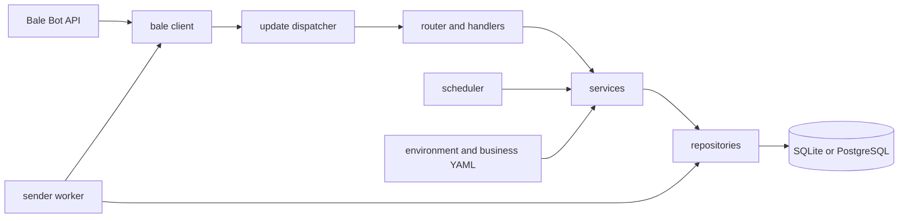

# Architecture

The Bale client is the only layer that makes HTTP requests. It maps response envelopes into typed models and exposes safe errors. Handlers perform authorization and input parsing; services own business rules; repositories own database queries. Services do not import handlers.

The schema is single-tenant. Subscriber chat IDs are the messaging address; phone numbers are optional matching metadata and do not create a subscription. Subscriber consent and opt-out state are persisted. Campaign recipients are intended to be materialized as a durable snapshot before sending.

The admin campaign wizard stores its progress in `conversation_states`, so an interrupted wizard resumes after process restart. It saves the source chat/message pair and previews with `copyMessage`; it does not reconstruct or reformat the payload. Audience filters include every selected tag and exclude any selected tag, always against active subscribers. The recipient count shown in the draft is a preview; the sender must materialize a fresh recipient snapshot when the campaign starts. Campaign CTA buttons are stored separately and are sent as an explicit follow-up after the copied payload because `copyMessage` has no documented keyboard override.

Time-sensitive operations accept an explicit timestamp or clock. Database timestamps use UTC; business-local scheduling and display use the configured IANA timezone, defaulting to `Asia/Tehran`.

## Delivery guarantee

The database stores each campaign-recipient pair uniquely and tracks a recipient through `pending`, `sending`, and a terminal state. A process crash or ambiguous network timeout after Bale accepted a copy but before the database recorded success can result in a duplicate on recovery/retry. Delivery is therefore at-least-once across that failure window; Bale does not expose an idempotency key for `copyMessage` in the API contract used here.

## Durable state

The schema includes subscribers and tags, admins, conversation state, processed update IDs, campaign and recipient records, application state, and a scheduler lease. Migrations are applied with `python -m bale_campaign_bot.cli migrate` and should be backed up before production upgrades.
